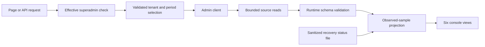

# Platform operations read model

## Scope

The platform operations console is a local, read-only projection for platform operators. It combines existing tenant, membership, profile, audit, quota, OCR, and recovery evidence. The projection is an observed sample. It is not a product analytics ledger, an invoice system, or proof of production recovery.

The console has six views:

| View | Contents |
| --- | --- |
| Resumen | Tenant count, observed changes and operations, recorded cost coverage, source health, and links into the other views |
| Tenants | Per-tenant membership, observed actor, audit, OCR, and recorded cost summaries |
| Uso | Observed activity by actor and complete UTC day, week, or month |
| Costos | Signed recorded movements, known recorded estimates, and unknown price coverage |
| Trazabilidad | Redacted audit changes and OCR operation correlation |
| Salud y backups | Observed OCR outcomes, duration samples, source states, and sanitized recovery evidence |

The page entry point is `app/admin/operations/page.tsx`. The JSON entry point is `GET /api/admin/operations`. Both call `loadOperationsSnapshot` and return private, uncached results.

## Authorization

`loadOperationsSnapshot` calls `getUserRoles` before it creates an admin client. The effective role must be superadmin. Permission simulation changes the effective role, so a simulated non-superadmin receives `403` even when the underlying account is a superadmin.

The route never accepts a service-role credential or an authorization override from query parameters. The supported query is:

| Parameter | Values | Default |
| --- | --- | --- |
| `tenantId` | One tenant UUID | All tenants in the bounded inventory |
| `days` | `7`, `30`, or `90` | `30` |

An invalid query returns `400`. A selected tenant that does not exist returns `404`. Per-source failures remain in the snapshot with their source state. An unhandled server failure returns a sanitized response.

## Read flow and limits

The loader applies these limits:

| Source | Limit | Period |
| --- | ---: | --- |
| Tenants | 200 | Current inventory |
| Memberships | 1,000 | Current inventory |
| Profiles | 1,000 observed people | Current inventory, in batches of 100 |
| Audit | 1,000 | Each current and previous period |
| Usage and OCR phases | 1,000 | Each current and previous period |
| Mutable OCR document state | 1,000 | Each current and previous period |

Event sources load in pages of 250. A direct `tenantId` selection can load a tenant outside the 200-tenant inventory sample. Source rows pass through strict runtime schemas before projection.

Every source reports one state:

- `available`: all returned rows passed validation and the result did not reach the cap.
- `partial`: at least one row failed validation, a later page failed, or the limit truncated the result.
- `unavailable`: the source failed before it returned any valid rows.

The console keeps usable sources when another source is partial or unavailable. Coverage text states what each source can and cannot prove.

## Observation windows

The window uses UTC and half-open intervals. For a 30-day selection made during 2026-10-17 UTC:

- `start` is the start of 2026-09-17 UTC.
- `end` is the start of 2026-10-17 UTC.
- `liveEnd` is the current request time on 2026-10-17 UTC.
- `previousStart` is the start of 2026-08-18 UTC.

Activity and cadence use records before `end`, so they contain completed UTC days. Audit, cost, OCR operation, and source-health views can use records through `liveEnd`. The current day is partial and does not contribute to activity comparisons.

The response sets `measurement` to `observed_sample`. Truncation, invalid rows, collection gaps, mutable sources, and missing historical actor eligibility prevent adoption claims. The console does not infer zeros outside observed coverage.

## Source contracts

### Tenant identity

Tenant rows supply the bounded inventory. Current memberships supply roles and known tenant members. Profiles supply display names for up to 1,000 member or observed actor IDs. A missing profile falls back to a shortened actor ID.

Memberships are current state. They do not reconstruct who was eligible during an earlier period.

### Audit

Audit reads expose the action, table, row ID, changed field names, actor ID, and timestamps. The projection returns before and after values only for these fields:

- `status`
- `is_active`
- `rows_extracted`
- `retry_count`
- `processing_duration_ms`
- `materialization_version`

`hiddenFieldCount` reports changed fields outside the allowlist. The projection does not return arbitrary JSON values. It preserves an exact extraction ID from the structured context or known OCR records so audit, usage, and OCR state can join on the same operation attempt.

Audit coverage depends on deployed triggers and actor attribution. A table with no observed audit row is not proof that no change occurred.

### OCR attempt phases

`recordOcrObservation` writes zero-amount `ai_tokens` rows with these contexts:

- `ocr_operation_started`
- `ocr_operation_completed`
- `ocr_operation_failed`

The metadata contains bounded identifiers, actor origin, exclusion flags, duration, row count, or a normalized error code. It does not contain document text, provider responses, credentials, or arbitrary errors.

Phase writes are best effort. They are separate from the OCR business transaction and can be lost. No database uniqueness constraint makes them exactly once. The read model deduplicates repeated phases with the same tenant, extraction ID, and phase inside the loaded sample.

The extraction ID identifies one server route attempt. Automatic or manual retries receive new extraction IDs and count as new OCR request attempts. The `ocr_requests` metric therefore counts observed requests. It does not count unique human tasks or successful business outcomes.

OCR human activity requires a known, server-verified origin. A regular request attributes the authenticated user. An impersonated request attributes the initiating operator and retains the executing identity for investigation. Demo, preview, permission-simulation, impersonation, test, and unknown-origin attempts do not contribute to ordinary human activity. Audit activity uses the stored audit actor and carries the audit source's attribution limits.

### Mutable OCR document state

`ocr_document_processing` supplies the latest stored state for a document path and table. It is a fallback when phase evidence is missing. It can show pending, processing, completed, or failed, plus an extraction ID, row count, duration, and normalized error code.

This table is mutable. Reprocessing can replace an earlier state, so the source cannot establish a full execution history. Multi-table attempts merge records only when they share the exact tenant and extraction ID.

### Recorded quantities and costs

`tenant_usage_events` records signed resource movements and zero-amount observations. The console groups resource movements as `storage_bytes`, `ai_tokens`, and `whatsapp_messages` by tenant. Existing expense feeds exclude the three OCR observation contexts before their recent-event limit, so phase events do not displace resource movements.

Known reservation and rollback contexts are ineligible for priced-event and unpriced-event counts. Their signed amounts remain in `netAmount` because that field reports the recorded ledger sum. Reservation, settlement, retry, or compensation patterns can make `netAmount` unsuitable as incurred usage and can double-count a quota quantity. The console labels the basis as `recorded_estimate`.

`knownUsd` includes only a finite, nonnegative `costUsd` attached to an eligible record. A missing price stays unknown. The local read model has no invoice imports, price-version source, shared-infrastructure allocation, currency conversion, or reconciliation between estimates and actual charges.

### Recovery evidence

`lib/operations-recovery.ts` reads only the absolute file path configured through `OPERATIONS_RECOVERY_STATUS_PATH`. A missing variable produces `unconfigured`. A relative, missing, oversized, malformed, schema-invalid, private-field, or symlinked status file produces `unavailable`.

The application reads the sanitized status contract. It never reads the private recovery manifest, backup artifacts, credentials, or tenant data. The contract covers four required scopes:

- database.
- Auth.
- Storage configuration, metadata, and object bytes.
- application and provider configuration with secret references.

The verifier recalculates artifact sizes and SHA-256 checksums. A complete state also needs a separate checksummed restore attestation for the same recovery set. The attestation records isolation, disabled side effects, component results, and application checks. The verifier does not independently observe those claims, so the console presents the restore result as a recorded attestation.

No production capture, upload, scheduler, retention policy, restore environment, or Auth recovery runs from the application.

## Known limits and future work

The local console adds no schema or dependency. It does not activate production collection or backup work.

The next data layer needs:

- a versioned catalog for human business actions.
- stable logical operation IDs that separate one human task from its retry attempts.
- a transactional outbox for business changes and semantic facts that must commit together.
- broader instrumentation across product features.
- deterministic provider pricing, invoice reconciliation, shared-cost allocation, and currency handling.
- authorized production backup capture, an independent destination, retention, complete Auth and Storage recovery, alerts, and isolated restore drills.

See [ADR 0039](../adr/0044-platform-operations-observed-data.md), the [platform telemetry plan](../../plans/2026-10-17-platform-telemetry/README.md), and the [backup and recovery runbook](../supabase-backup.md).
