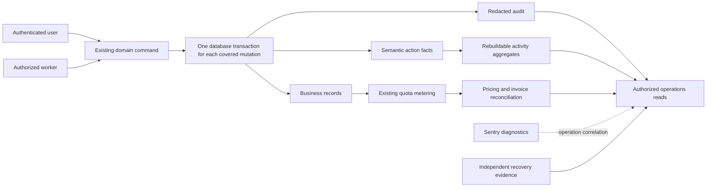

# Platform telemetry and tenant operations plan

Status: first application increment implemented locally, 2026-10-17. `/admin/operations` and its private API read authorized, bounded source data. OCR routes record correlated attempt phases, and local recovery tooling validates artifacts and recorded restore evidence. Production deployment, database queries and actual backup activation remain unverified. The broader architecture below remains a proposal beyond this increment.

See [implemented architecture](../../docs/architecture/platform-operations.md), [metric definitions](../../docs/domain/platform-operations.md), and [the actual React component preview](runtime-output/index.html). The preview uses labeled synthetic data and a navigation fixture, with [browser evidence](runtime-output/verification.json). It is distinct from the earlier standalone visual proposal.

To serve that fixture persistently, run `node plans/2026-10-17-platform-telemetry/serve-console.mjs 6073`. It listens on loopback and permits only the generated HTML, JavaScript and CSS plus an empty favicon response. It exposes no application APIs or repository files. A user-authorized temporary Cloudflare preview was checked across all six views on a mobile viewport; its process IDs, current URL and verification receipt live under the ignored `.codex-temp/operations-share/` directory. Starting the full Next application remains a separate step under the repository's server-start rule.

The user subsequently authorized the actual local app. Its Next server, Cloudflare tunnel and same-origin local API bridge are running separately, with current metadata and sanitized evidence in `.codex-temp/sintesis-share/`. The bridge helper is `share-sintesis.mjs`; [ADR 0040](../../docs/adr/0040-local-app-sharing-browser-connection.md) describes browser routing and preserved authentication. Server clients keep their configured local gateway. The full Vitest suite passed with 349 tests. The public app, email form and anonymous permission boundaries were checked; successful account access requires the user's own login. Use email/password for this temporary session because Google provider callback settings were not reconfigured.

Build on Supabase and Sentry first. Keep business audit, product activity, resource metering and technical diagnostics distinct, linked by operation identifiers where available. Design and exercise the visual console immediately with labeled synthetic data, then connect each view to verified sources. Real dashboards must distinguish historical coverage from periods before collection began.

## Assumptions and current gaps

The initial audience is the platform operator. Existing tenant-admin access remains as implemented; extending access is a separate decision. Operating expenses mean costs attributable to serving each tenant, including AI, storage and WhatsApp. The user has been asked to confirm the audience and cost interpretation.

| Requested improvement | Current evidence | Target |
| --- | --- | --- |
| Technical telemetry | Production Sentry and Vercel monitoring; process health endpoint | Correlate failures, latency and jobs with tenant/operation, with sensitive fields removed and source freshness visible |
| Tenant visualization | Identity, owner, invitations and switching | Searchable tenant overview with activity, consumption, attributable costs and links to tenant details |
| Production backup | Procedure documented; automation and production restore success unverified | Complete recovery sets, independent encrypted copies, freshness monitoring and tested restores |
| Creates, edits and configuration traceability | Database audit and separate domain histories, with coverage and actor gaps | Investigate who changed what, when and why, with redacted field differences and explicit automation attribution |
| Tenant expenses | Monthly quantities/limits and partial AI estimates | Distinguish invoice actuals, versioned estimates, shared allocations and unknown costs |
| Feature usage and frequency | Resource deltas and recent-event tables | Human actions and task outcomes by user/tenant/feature, with daily, weekly and monthly recurrence |

See [the current operating model](current-model.md) and [source evidence](evidence.md). These describe local code and migration intent, not deployed production state.

## Visual operations console

The console is a primary deliverable. Operators need to inspect tenants, repeated customer work, costs, changes and recovery from connected visual views. The shared tenant, period and observation context follows the investigation across six perspectives: Resumen, Tenants, Uso de funciones, Costos, Trazabilidad, and Salud y backups.

The [visual design contract](visual-design.md) specifies the screens, visualizations, click-through journeys, source states and responsive acceptance checks. A local interactive proposal uses explicitly fictional tenants and values; it has no production connection and changes no database. Verify this interaction model before integrating sources. Shipping the console is incremental alongside collection, rather than a final dashboard task after every backend capability is complete.

## Architecture and ownership



The transaction shown covers only facts written in that transaction. Existing provider calls, billing reservations and Storage object changes keep their own idempotency/compensation rules; this plan does not make external systems transactional.

- Existing domain modules own mutations. Add dedicated database RPCs only where a covered action needs its business change, audit and semantic event to commit together. Separate Supabase REST requests do not share a transaction. Avoid a new generic command engine or rewriting every mutation at once.
- PostgreSQL audit triggers own covered row-change evidence. Keep existing domain-specific histories and stable lineage identities. Correlate them rather than creating duplicate histories with conflicting meaning.
- Proposed `lib/product-activity/` owns one versioned action catalog, aggregation definitions and observation coverage. Product facts do not replace quota counters in `lib/tenant-usage.ts`.
- Proposed `lib/operating-costs/` owns versioned pricing and reconciliation. `lib/tenant-expenses.ts` keeps its existing quantity display contract until callers migrate deliberately.
- Proposed `lib/tenant-operations/` owns bounded, authorized composite reads. Each section returns its own coverage and freshness. An unavailable source is not zero activity or zero cost.
- A recovery runner outside the request path owns recovery sets. Its evidence must remain available when the production database fails. The app receives a sanitized read projection, not backup credentials.

Cross-tenant queries require explicit effective platform authorization, including permission simulation. A service-role client is an implementation tool, not proof of permission. Preserve the existing limit-manager exception within its current limits scope; it must not gain audit, user-activity or general platform access. Tenant scopes are validated server-side before querying each source. Never trust actor/tenant IDs supplied by a browser as authority.

## Caller contract sketch

These examples are design contracts, not importable or implemented APIs. Supporting ID/config/query types remain owned by their domains.

```ts
// Configuration route: one accepted command owns its transactional facts.
const saved = await saveTenantDataFlowConfig(session, {
  operationId, expectedVersion, config,
});

// An existing durable extraction job is the operation identity.
await completeExtraction(worker, { jobId, result });
// Load tenant and initiator from that job. The worker is the executor.

const overview = await readTenantOperations(session, {
  scope: { kind: "platform" }, from, through, reportingTimezone,
});
```

```ts
type Actor =
  | { kind: "human"; userId: UserId; impersonatorId: UserId | null }
  | { kind: "system"; job: JobName };

type Attribution = {
  initiator: Actor;
  executor: Actor;
};

type ActionPhase = "accepted" | "completed" | "failed" | "cancelled";
type Observation =
  | { kind: "complete"; from: Instant; through: Instant }
  | { kind: "partial"; observed: Interval[]; gaps: Interval[] }
  | { kind: "unavailable"; reason: string };

type OperatingCost =
  | { kind: "actual"; money: Money; invoiceLine: InvoiceLineId }
  | { kind: "estimated"; money: Money; rateVersion: RateVersion }
  | { kind: "allocated"; money: Money; allocationVersion: AllocationVersion }
  | { kind: "unknown"; reason: string };

declare function saveTenantDataFlowConfig(
  session: VerifiedSession, command: SaveTenantDataFlowConfig,
): Promise<DataFlowConfig>;
declare function completeExtraction(
  worker: VerifiedWorker, command: CompleteExtraction,
): Promise<ExtractionResult>;
declare function readTenantOperations(
  session: VerifiedSession, query: TenantOperationsQuery,
): Promise<TenantOperations>;
```

Tenant identity comes from the verified session/selected authorized scope, or from an existing durable job for workers. IDs and instants are validated semantic types at the boundary. A client-provided `operationId` is only an idempotency key. Conflicting payload reuse fails; a stale retry cannot overwrite a later configuration save. Define the version contract in the first domain RPC before implementing it.

Prefer existing job/run IDs. Add a separate operation ledger only for a domain that lacks a durable identity and requires crash recovery. Unique event IDs prevent duplicate event capture; they do not by themselves make a business mutation or external side effect idempotent.

## Action and audit contract

Start with `configuration.saved`, `obra.created`, `document.uploaded`, `extraction.requested`, `extraction.completed` and `document.generated`. Before instrumenting each, record its owner, success boundary, phase, counting unit, allowed dimensions, actor rules, availability date and existing domain-history reference. Expand to table edits, reports, exports, document views and workflows through that same catalog.

A bulk command is one task with a separate affected-object count. Autosave is a distinct action with an explicit coalescing boundary, so each keystroke does not become a task. Per-row audit retains the actual changed records. Resource reservation, settlement, rollback, polling, retries and page rendering are not task completions.

For asynchronous work, preserve two facts: a human's request was accepted, and an executor later completed or failed the job. Measure human interaction frequency using accepted requests and successful synchronous actions. Measure successful output using completion events. Do not count acceptance and completion as two human tasks. Scheduled work has a system initiator; work requested by a human retains that initiator while recording its system executor. Exclude demo, test, permission-simulation and impersonation traffic from ordinary adoption, with an explicit filter to investigate it.

Audit records need tenant, initiating/executing actor, operation, entity identity, action, timestamp, changed field names and allowlisted values. Never copy secret values, document bodies, messages or arbitrary JSON wholesale. For secrets, record rotation/change outcome and secret identity only. Existing full JSON needs read-time redaction first; historical sanitization and retention deletion require a separate approved stored-data operation.

For covered mutations, audit failure rolls back the database change and unresolved tenant/actor scope is an explicit error. Preserve legitimate system actors. Review grants/RLS so clients cannot forge audit rows or action facts. Apply this per covered path, with tests, rather than replacing global triggers across all domains in one step.

Append-only semantic facts use stable operation/action/phase/version uniqueness. Store authoritative UTC times and bounded dimensions. Index reads by tenant/time/action and tenant/actor/time; audit investigation also needs tenant/entity/time and stable cursor ordering. Choose final indexes after inspecting actual query plans. Aggregates are rebuildable from source facts, with watermarks and coverage intervals; replay must not increment them twice.

## Metrics for product decisions

| Question | Metric | Decision and limits |
| --- | --- | --- |
| Which features do customers use? | Distinct human users and tenants with a qualifying action, grouped by feature and period | Identify concentrated or unused capabilities. Adoption percentages need a verified eligible-user/tenant denominator and historical availability. |
| What do they repeat daily, weekly or monthly? | Task count, distinct active days/weeks/months, active-period ratios and median interval between active days per user/tenant/action | Identify repeat work and automation opportunities. Do not infer cadence from total clicks or AI tokens. |
| What does serving each tenant cost? | Actual, estimated and allocated cost by service/period, plus unpriced quantities and unmatched invoices | Investigate expensive workflows and pricing. Keep partial coverage visible. Cost per successful output requires a matching action and cost scope. |

Store event instants in UTC. Billing keeps its existing UTC-month rules. Product reports use an explicit versioned IANA timezone, initially UTC until a tenant reporting timezone is approved. Use half-open calendar intervals; weeks start Monday. Evaluate the last 28 complete days, eight complete weeks and three complete calendar months. Show the current partial period separately.

For a person/action, `active_days / eligible_days` means distinct local dates with qualifying human activity divided by dates with complete collection and verified observation eligibility. Equivalent definitions apply to weeks and months. Exclude periods before instrumentation or membership observation. A gap or new feature produces incomplete coverage or insufficient history, not an invented zero.

Show ratios and the selected calendar window first. Exact labels such as "every day" require every eligible complete day in the stated window; weekly and monthly labels can overlap. Do not assign mutually exclusive habit classes or workday-based thresholds until the customer calendar is defined. A task repeated each weekday should remain understandable through the weekday distribution and active-day ratio, even when weekends are inactive. Sparse history cannot establish a monthly habit.

Report cadence per individual before aggregating tenant patterns. Tenant activity is the union of human activity and can look daily when each person acts only weekly. Distinct-user totals come from actor identities, not sums of daily distinct counts. Late events revise affected buckets; publish the ingestion watermark and revision time. Never reconstruct historical product actions from resource deltas or sampled traces.

No customer baseline, monetary total or usage target has been measured. Establish observation coverage before setting adoption targets or anomaly thresholds.

## Cost and recovery truth

An effective-dated price needs provider/model, input/output/cache or other applicable usage units, currency, source and rate version. Missing prices remain unknown. Treat storage snapshots separately from byte-hours/GB-month billing; uploaded bytes alone do not measure storage cost. WhatsApp rates require the actual billable event dimensions. Keep costs incurred by failed/retried provider calls even when a business task fails.

Reconcile invoice lines to corresponding estimates before consolidation. Never sum an actual charge with its estimate. Shared infrastructure allocations carry a versioned allocation rule and an unallocated remainder. Preserve currencies unless an approved dated FX source is available. Current quantity limits continue to work independently of pricing.

Recovery applies to the platform. Do not label each tenant as having an independently restorable backup without evidence. Show last complete recovery set, last validated restore, capture coverage, freshness and failures separately. The corrected [backup runbook](../../docs/supabase-backup.md) defines database/Auth/Storage/configuration coverage, consistency, external side-effect isolation and approval requirements. It does not activate production backup automation.

## Implementation sequence and acceptance

Stages 1 and 2 can run in parallel after their separate approvals. Keep each delivered increment independently reviewable. Each implementation must first recheck the live code and existing user changes.

| Stage | Concrete change | Acceptance proof | Authority needed |
| --- | --- | --- | --- |
| 0. Design and baseline | Source inventory, competing architecture review, corrected recovery requirements | Verify source/file links; run existing usage-write and tenant-limit access tests | Local documentation only |
| Visual proposal and ongoing integration | Interactive six-view console with tenant drilldown, frequency calendar, cost breakdown, change inspection and recovery coverage | Exercise navigation and shared scope, synthetic/unknown states, keyboard, narrow/wide layouts and both themes; then integrate each approved source incrementally | Local synthetic prototype needs no schema or production access; real route and external documentation follow project workflow |
| 1. First trustworthy action | Tenant data-flow config save gains a redacted audit trail and one semantic action through a dedicated RPC; define optimistic version/retry behavior | Disposable DB proves commit/rollback, two concurrent requests, stale retry, actor attribution, redaction and cross-tenant denial | Approve additive schema/RPC/grant changes and disposable DB mutation |
| 2. Production recovery | Implement runner, private destination, manifest, retained Storage versions and restore proof | Successful complete upload, interrupted-upload failure, stale-job alert and isolated database/Auth/Storage restore | Approve project, credential use, destination, retention, recovery objectives and any spend |
| 3. Action coverage and telemetry | Instrument obras, upload, extraction and document generation; add scrubbed correlation to Sentry | One human request/one task despite retries/bulk/background execution; worker/system separation, lost/late-event coverage, no sensitive payloads | Approve further schema changes only if needed; production rollout separately |
| 4. Product frequency | Bounded aggregate queries and actor/action reports | Synthetic fixtures for DST, month/year boundaries, membership start, coverage gaps, timezone change, weekday patterns and late events | Approved reporting/retention contract; schema additions if needed |
| 5. Operating costs | Rate versions, native-currency estimates, invoice reconciliation and shared allocations | Fixtures for input/output prices, missing rates, failed charged calls, byte-time units, duplicate invoices, estimate replacement and currency separation | Approved rate sources; account access/imports and any schema changes separately |
| 6. Connected operator views | Finish connecting the already designed tenant console to validated activity/cost/health and filtered audit sources | Empty/loading/partial states, server pagination, scope denial, permission simulation, navigation and real fixture-backed browser checks | Product scope approved; existing server/UI conventions and FigJam workflow |

Do not ship UI that calls a missing schema or treats collection start as historical coverage. Each source is independently fresh/stale/unavailable. No production database reset, clone, migration push or restore is part of Stage 0.

Before any visible implementation, read `docs/styleguide/design-system.md` and inspect Product OS plus Journeys 04 / Plataforma y Acceso per `app/AGENT_CONTEXT.md`. Record proposed work as proposed and shipped behavior only after validation. Existing flows missing from those maps must be documented during their implementation increment. No FigJam writes are made by this planning change.

For implementation, add an ADR for the approved collection/audit/storage/permission decisions, domain definitions for action units and cadence, architecture contracts for RPCs/events/aggregate reads, and the nearest context-file updates. This plan does not mark a proposed architectural decision accepted. No styleguide change is needed until a reusable UI rule changes.

## Synthesis and verification

The Postgres design is the proposed base because it reuses current infrastructure and keeps authoritative mutation facts in the same transaction. The [hybrid alternative](candidates/hybrid.md) adds an external delivery, retention and data-transfer boundary before a measured workload justifies it. The [database candidate](candidates/database.md) supplies the transaction and reconciliation model. Adopt the hybrid design's explicit impersonation, ingestion coverage and human-request/system-executor distinction. Defer a generic operation ledger; reuse domain job identities first.

The independent review and final verification results are recorded in [verification.json](verification.json). Existing tests confirm only the current disabled usage POST and tenant-limit access rules. They do not prove a new event pipeline, recovery automation or production restore.

## Next decision

The first production data increment is Stage 1: one tenant configuration save with verified audit and product activity. It needs approval of its concrete migration/RPC/versioning contract before changing schema or stored data, as required by `AGENTS.md`. Visual console design and local interaction checks proceed independently of that approval. Production backup activation needs the separate Stage 2 operational choices and authority. Neither requires choosing a new analytics vendor now.
