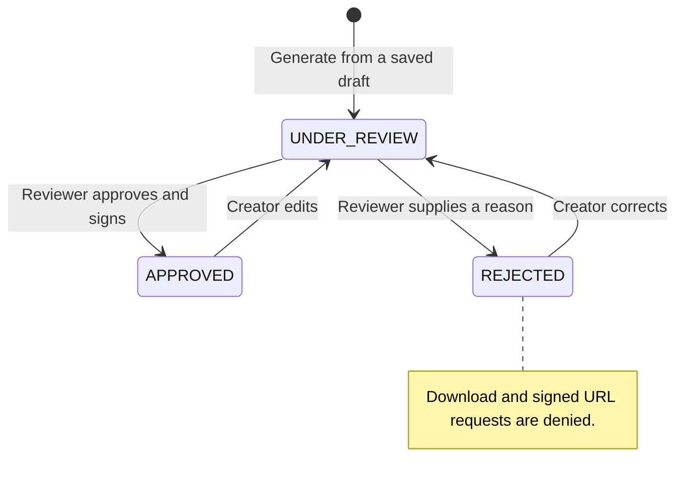

# Deep document workflow verification

## Work list

- [x] Frame: test complete document workflows against owned local Auth, PostgreSQL and Storage. Preserve current unrelated changes; no credentials, external accounts or ordinary database.
- [x] Fan out: three distinct slices, extraction/files, document templates, document lifecycle; independent review added persistence and UI gaps.
- [x] Aggregate: integrate shared fixture requirements and run the actual browser/HTTP cases. A test file or screenshot alone is not a passing workflow.
- [x] Report: link named cases, persisted/artifact outcomes, permission/recovery coverage and every remaining provider or feature gap.

## Acceptance

1. Configure a data extraction folder/schema, upload actual synthetic image/PDF/document bytes, reload and read them back. Prove unsupported/invalid inputs and foreign-tenant access do not create or expose artifacts. Label provider substitution precisely; no mocked application endpoint may establish end-to-end extraction success.
2. Create a document template, reload, edit its configuration, and prove the rendered/required input contract through the real product entry. Keep template persistence separate from provider-backed generation.
3. Save a draft, recover it, generate an actual artifact, edit without losing data, approve/reject through appropriately permitted independent users, and verify persisted status/history and download behavior. An approved edit must return to review; a rejected document must not yield downloadable bytes or a signed URL. Test tenant boundaries and failed operations without discarding unsaved content.

Workers own disjoint specs/helpers and reports. The root owns shared fixture/runtime changes and executes one disposable integration stack at a time. Existing fast component-session race coverage remains useful but does not prove backend persistence or PDF rendering. Scope expansion beyond these slices is recorded rather than silently called complete.

## Named coverage

| User outcome | Executable case | Independent proof |
| --- | --- | --- |
| Create a data extraction folder | `documents/files-and-extraction.spec.ts` | Fresh-session table/schema/pipeline and actual Storage folder marker |
| Upload PNG, PDF, text and DOCX | Same file | Browser upload, exact Storage bytes, fresh tree, protected downloads and decoded DOCX XML |
| Reject an invalid spreadsheet and recover | Same file | Actual CSV parser, no failed-import rows, fresh API/RLS rows and source lineage |
| Extract PNG/PDF data | `documents/ocr-provider-boundary.spec.ts` | Actual routes/Storage/SQL; transport validates source SHA256/MIME; retry and reimport preserve row identity |
| Upload and retry OCR from the document UI | `documents/ocr-user-flow.spec.ts` | Actual file chooser, visible provider failure, persisted failure, retry control and fresh-session table rows |
| Move away while a folder is loading | `documents/folder-navigation.spec.ts` | Hold and continue the real folder GET; newer folder and file remain usable; fresh context recovers both folders |
| Create and edit a template | `document-generation/templates.spec.ts` | Real config UI, fresh RLS row/UI, typed validation, generator and stored artifact |
| Deny invalid and unauthorized template changes | Same file | Rejected duplicate schema, no phantom template, corrected draft, member and foreign-tenant denial |
| Create, edit, approve, reject and resubmit a document | `document-generation/lifecycle.spec.ts` | Actual renderer/downloaded PDF text, independent reviewer, persisted lifecycle/history and rejected-download denial |
| Continue typing during a slow save | `document-generation/recovery.spec.ts` | Delayed real POST, newer edit survives, first revision then latest revision read from SQL, same draft ID after reload |

All thirteen cases behind these rows passed in the final frozen runtime below. The rows distinguish visible UI actions from route/provider variants; they do not claim live OCR recognition quality or completion of all application workflows.

The lifecycle case follows one generated document through every transition below. Each decision uses the independent reviewer's visible form, and each correction uses the creator's editor. The source draft remains a separate linked record. The test checks six ordered history events, actors and comments, plus the actual PDF content.



## Boundaries

- Gemini's response is simulated at the external HTTP boundary. App routes, validation, plan accounting, Storage, SQL and RLS execute normally. This proves orchestration; recognition quality and live-provider compatibility remain untested.
- Uploaded DOCX is checked as an actual OOXML ZIP and persisted/downloaded bytes. This does not establish DOCX preview or Word editing behavior.
- A delayed same-tab save does not establish cross-tab conflict handling or offline reconnection.
- These document workflows do not complete the application's forty-workflow matrix. Certificates, insurance, billing, invitations, notifications, WhatsApp, model conversion and destructive restore/purge jobs still need their own durable journeys.

## Execution record

- `d2e25881-63e6-454c-b8be-611b44c0210e`: initial document lifecycle passed 1/1 against the owned runtime. Final strengthened UI/artifact assertions require the frozen rerun.
- `efe9e445-75b5-4c0d-a6b2-6204427addb0`: 2/6 passed. Preserved failures exposed an ambiguous template locator, the wrong file-manager entry, and an incorrect table row-count summary. Driver corrections and independent row/count readback were added; no assertion was removed to make the result green.
- `1f28e109-6fa9-4d5e-b7f6-4e0ec8fd0920`: 4/10 passed. Independent reads proved two persisted CSV rows despite summary zero (`PGRST100`). OCR exposed discarded provider status and lost existing-source linkage. The template trace proved initial loading reset a form already being edited.
- `f6206f33-4fd6-4dce-ba9a-698816867bf3`: 6/11 passed. CSV persistence/count, PNG outage/retry/reimport and PDF multi-table reimport passed. Remaining failures identified empty Storage folders omitted from the lightweight view, a JSON-editor ancestor locator, the review response-event driver gap, and a single-table catch converting a typed provider outage into 422. The single-table route now lets recognized failures reach its outer classifier while retaining ordinary unprocessable-extraction behavior.
- `f9516715-8bc8-4ec6-b64e-882942463b32`: 9/11 passed. The strengthened lifecycle passed all six transitions, signature PDF text, revision history and rejected-download checks. Upload of all four formats, CSV count/readback, same-tab save recovery, all three provider-boundary cases and two template API cases passed. The remaining cases exposed a label-contract assumption and unstable navigation after initial loading.
- `5a90a900-df67-4955-8bc0-5df7d2d489e7` and `bc46f695-c278-44f5-9cc7-b43411cc9e88`: both focused reruns failed 0/2. Template validation was cleared by a full document reload. Fresh folder traversal returned to root before the child could be opened. Both symptoms retain screenshots and traces; source review identified stale folder request ownership and shallow-tree replacement. The template reload cause is still being isolated from development-server behavior.
- `87037b06-a5ba-4c29-b5cb-5b601660a947`: diagnostic 0/2. CDP conclusively attributed the editor reload to Next HMR's SYNC hash mismatch. OCR reached the actual provider 503 and persisted failure; the new UI case corrected its invalid null-count assumption to the initialized zero.
- `0e9a0187-2c8e-447e-9e77-c5689060ab67`: 0/3. Suppressing the whole HMR socket stalled React's development stream and was rejected. The narrower implementation keeps the socket connected and pins only SYNC hash values. OCR now reached successful no-reload retry, but its assertion incorrectly ordered business rows by opaque lineage hash; the driver now sorts by literal item code.
- `d5da87ec-8fad-417a-8b42-d01f7115f08b`: 2/4 passed. The full UI-created typed template produced the verified PDF. PNG upload → visible 503 → no-reload retry → fresh-session rows passed. Parent/child navigation still failed even without a hard page reload, disproving HMR as its complete explanation. The delayed-folder-response case exposed the same selection problem; it remains under diagnosis.
- `16894ba6-5d2f-4b8e-b6bd-b47590e95ca0`: extraction-folder creation and fresh parent/child traversal passed after the pending URL-intent repair. The second case stopped before its navigation sequence: obra setup's actual PATCH failed with `ECONNRESET`. Its failure is retained; no unsafe write retry or assertion bypass was added. The delayed-load regression is rerun in a fresh owned stack.
- `5f5ab628-88fe-4a90-9248-0222c6b3531c`: delayed folder load passed 1/1, including navigation through root, keeping the newer folder, opening its file and recovering both folders in a fresh actor context. Stack and fixture disposal verified before the full regression began.
- `c4e28499-9260-421b-bc3b-55aeceba3f2a`: first complete frozen run passed 48/49, with zero retries. All deep cases except the four-format upload case passed; that case failed before its workflow on another obra-setup `ECONNRESET`. Source hashes before/after match across 791 files. The local HTTP probe then proved browser-bound API contexts share a pooled socket across context closure and reproduced failure on an injected server close. The new fixture connection policy gives requests distinct connections and preserves WebSocket Upgrade without replaying writes. The three file workflows and the complete suite require a new frozen run after that fixture-only repair.
- `f99ac0d4-1854-4162-8cc7-a313380f1a3c`: all three file workflows passed together after the explicit HTTP connection policy. Creation/fresh traversal, all four upload formats with tenant denial, and stored CSV failure/recovery passed. Stack/fixture cleanup completed before the final full run. `final-source-change.json` confirms the only source difference from the first full run is `tests/e2e/fixtures/scenario.ts`.
- `7481fcd3-758d-470e-abe6-4746a2983c13`: final frozen run passed **49/49 in 21 files**, with zero retries, flaky results, skipped cases or unexpected failures. It includes all 13 new deep cases and the 36 existing regression cases.

## Final verification

- [Verification record](verification.json), [run manifest](full-final-run.json), and [complete test results](full-final-results.json).
- Vitest: **359/359 in 48 files**, [JSON evidence](vitest-results.json). UI/test TypeScript projects and the 1,163-control UI contract passed. New/changed focused code lint passed; existing OCR/table-route debt remains 38 errors and 4 warnings, with no increased findings, and the existing file-manager warnings remain 42. The repository-wide TypeScript check still has the unrelated portfolio raw-import error in [typecheck-full.txt](typecheck-full.txt).
- All **791 source/test/tooling inputs remained unchanged** through the final run. Their aggregate SHA-256 is `68ec3f8c5bbbcaac6ca5a7343aab0df6f01833bc2d06fba7b449447ded95a60d`. See [before](source-before-final-full.json) and [after](source-after-final-full.json).
- The final run verified and disposed **44/44 fixture scopes**. A fresh [cleanup readback](final-cleanup-readback.json) found no owned Docker containers, volumes or networks, no app process, no app/provider listener and no application snapshot. [All-attempt cleanup](attempts-cleanup.json) also verifies all 146 fixture scopes across the 15 diagnostic/final attempts. The initial lifecycle-only run predates the provider fixture and created no provider listener. Product soft-deleted SQL is removed with the owned stack, not inferred absent from DELETE responses.
- [Independent final review](final-review.md) found no material false-green risk in the thirteen cases. [Product repairs](product-regressions.md), [HMR diagnosis](hmr-runtime.md), and the executable [HTTP connection probe](http-connection-probe.mjs) retain the failure-to-fix evidence.

The complete regression selection excludes only `tests/e2e/independent-launch-qa-host.spec.ts`, a manual browser host belonging to another live thread. It deliberately holds a session open and is not a regression case. It was left untouched. Reproduce the 49-case selection from PowerShell:

```powershell
$specs = @(rg --files tests/e2e -g '*.spec.ts' -g '!*launch-qa-host.spec.ts' | ForEach-Object { $_ -replace '\\', '/' })
& node scripts/test-integration.mjs @specs
```

The [final approved-document screenshot](evidence/final-approved-document.png), [recovered draft](evidence/draft-recovered-after-reload.png), and [rejected editor](evidence/rejected-document-editor.png) are decoded copies of the passing run's actual screenshot attachments. Screenshots support the persisted/PDF assertions; they are not the proof by themselves.

Domain docs and ADR 0039 were updated. No production dependency, database schema, ordinary stored data, commit or deployment was changed by this work. FigJam remains pending because its quota was exhausted; the exact three boards and required updates are listed in [product-regressions.md](product-regressions.md).
